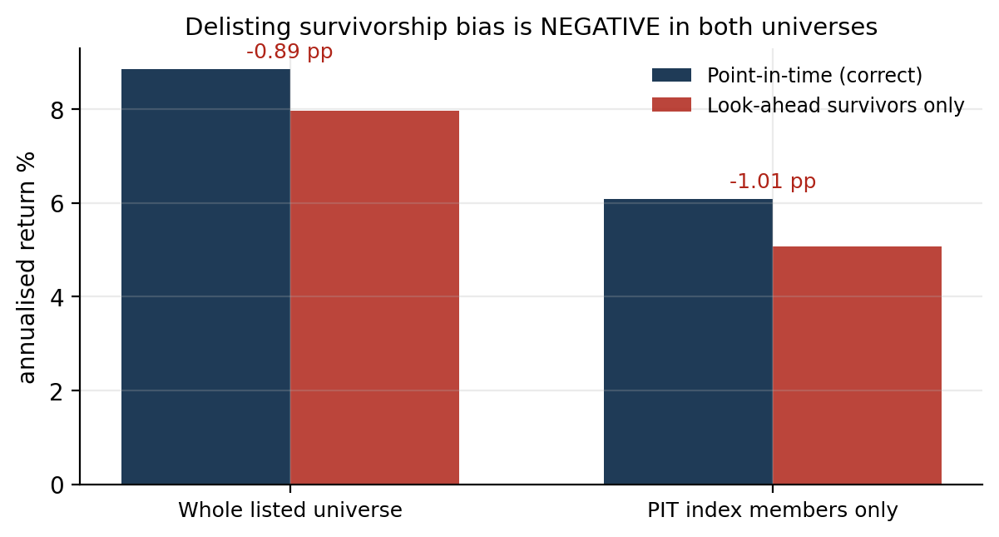
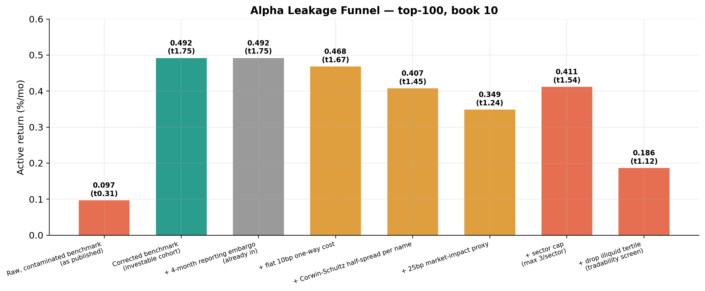
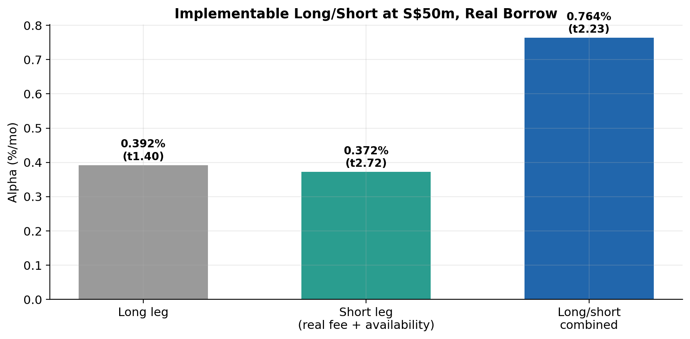

# SGX Multi-Factor Trading Strategy (NTU FYP A1083)

Does a multi-factor cross-sectional model earn a robust systematic premium on the Singapore Exchange, a smaller and less-arbitraged market than the US venues where factor premia decay fast? This repository is the consolidated, verified body of that project: every headline number below traces to an executed notebook cell or result artifact on real vendor data, catalogued row by row in [VERIFICATION_LEDGER.md](VERIFICATION_LEDGER.md). Numbers from earlier drafts that could not be traced, or that traced to fabricated data, were removed and are documented in [EXCLUSIONS.md](EXCLUSIONS.md).

The answer: the Singapore market contains real, correctly signed, replicable cross-sectional return structure, and the frictions of the market remove it before it becomes tradeable at institutional scale. Two methodological findings generalise beyond Singapore: survivorship bias on SGX runs in the opposite direction to the textbook prediction, and the reference literature's factor premia do not reproduce under honest multiple-testing discipline.

## Headline results

| Result | Number | Universe |
|---|---|---|
| Delisting survivorship bias is NEGATIVE (dead names raise returns; 59% of exits are takeouts) | −0.89 pp/yr (bracket −0.89 to −0.40 under harsh terminal-return assumptions) | 694-firm survivorship-free Compustat SGP |
| Survivorship correction reverses the broad long-short | survivor t=1.01 vs point-in-time t=3.82 | Broad Compustat, 1991–2026 |
| Blue-chip naive backtest vs corrected | Sharpe 1.002 → 0.447 | 71-name PIT roster |
| Cost waterfall on the winning composite | gross 1.661%/mo (t=5.13) → 0.282%/mo (t=0.85) fully costed | Broad Compustat, 2003–2026 |
| Dominant cost | Corwin-Schultz spreads, 0.906%/mo (median half-spread 23.5 bp) | same |
| Implementable long-short with real borrow (Markit) | +0.764%/mo (t=2.23) at S$50m AUM | top-100 |
| STI-core strategy | +0.396%/mo, NW-t 2.26; reproduces independently on Compustat at +0.36 (t=2.26) | PIT STI top-6 |
| Multiple-testing discipline | 65 pre-registered tests: 24 clear t=1.96, one clears t=3.0, zero survive BHY | dev window 1995–2019 |
| Reference paper's Table I | does not reproduce: 0 of 9 factors survive Bonferroni (best 2.767 vs 2.77) | PIT STI |
| Overlays (Barra, HMM, GBM, jump models, GARCH, Markov, IBES, jump sizing) | 8 tested, 8 failed to add risk-adjusted return | STI-core |
| Risk is jump-dominated | 57.9% jump variance; Gaussian understates 99% ES by 1.60pp (34%) | STI-core daily |
| TSMOM combination with fundamentals | reverses under borrow constraints (combo 0.460 < TSMOM 0.543) | liquid100 |







## What is where

| Path | Content |
|---|---|
| [REPORT_FINAL.md](REPORT_FINAL.md) | The consolidated research report; every number provenance-tagged |
| [VERIFICATION_LEDGER.md](VERIFICATION_LEDGER.md) | Claim-by-claim trace to executed evidence (VERIFIED / UNSUPPORTED / CONTAMINATED) |
| [EXCLUSIONS.md](EXCLUSIONS.md) | Everything cut, and why, including the fabricated-data quarantine |
| [MODULE_MAP.md](MODULE_MAP.md), `modules/` | How ten research branches fold into one core narrative plus seven modules |
| [DATA.md](DATA.md) | Sources, licensing, reproduction routes; no licensed data ships |
| `figures/` | 43 figures at 200 dpi, all from verified real-data runs |
| `code/` | Consolidated clean code: pipeline, factor model, backtest, PIT engines, canonical reruns, sensitivity scripts |
| `src/` | VBA data layer (Bloomberg and CapIQ pull machinery, point-in-time membership) |
| `results/verified/` | Aggregated result files backing the ledger |
| `data/synthetic/` | Labelled synthetic replicas (SYN01–SYN30, seeded) so the pipeline runs for cloners |
| `notebooks/` | Survivorship backtests, including the canonical quarterly-PIT run |
| `reports/`, `figs/`, `results/*.csv` (top level) | Historical drafts and the superseded diagnostic-track outputs, kept for the record; superseded numbers are catalogued in EXCLUSIONS.md |

## The corrections are part of the contribution

The project caught and fixed, in the open: a silent synthetic-data fallback (all downstream results rejected and rebuilt; the generator was reproduced exactly to prove contamination), a forward-return alignment bug that manufactured a fake U-shaped payoff, a GARCH look-ahead that inflated Sharpe 0.73 to 1.05, a Markov smoothed-probability illusion worth +0.525 Sharpe, a benchmark built from t+1 members that inflated the passive alternative by 0.395%/mo, a cost-base error producing a spurious 1,400%/month turnover figure, and the Corwin-Schultz liquidity-ordering inversion. Full log in REPORT_FINAL.md section 12.

## Reproduce

```bash
pip install -r requirements.txt
cd code
python make_synthetic.py                       # labelled synthetic replicas (no entitlements needed)
cp synthetic_panel_stock.csv panel_stock.csv   # feed the replicas to the model under the expected names
cp synthetic_macro_monthly.csv macro_monthly.csv
python factor_model.py
python backtest.py
```

With real vendor exports in place, run `python pipeline.py` first instead of the copy step; it fails loudly if any export is missing (there is no synthetic fallback in the pipeline). Verified end to end on the synthetic route at commit time.

Real-data reproduction requires NTU-equivalent entitlements (Bloomberg, WRDS Compustat/IBES/Markit/SDC, CEIC, JKP); routes are in DATA.md.

Nicholas Hong, NTU EEE, supervised by Prof. Patricia Wong. Educational and research use.
