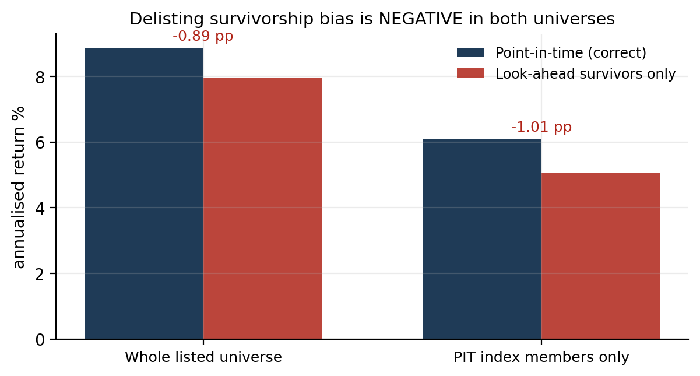
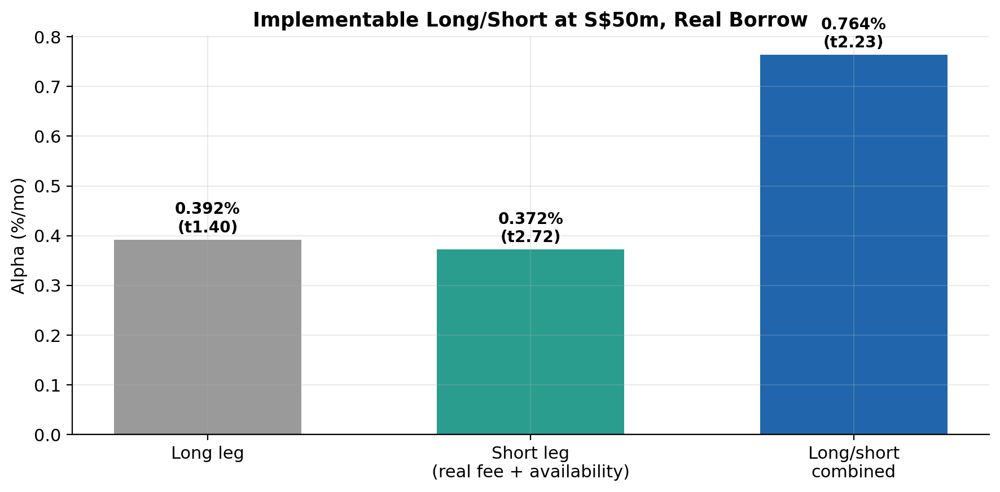
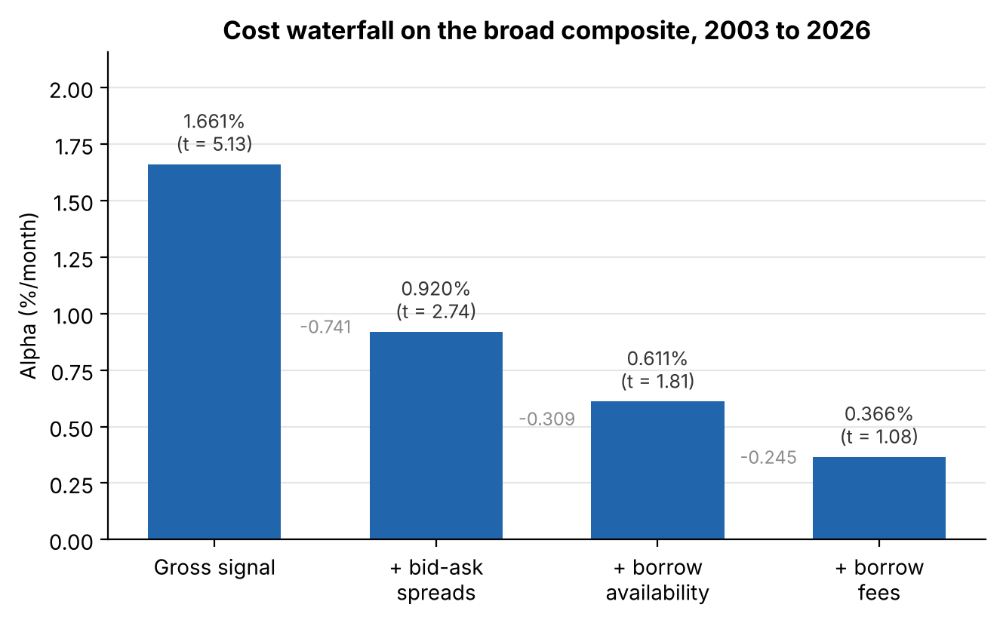
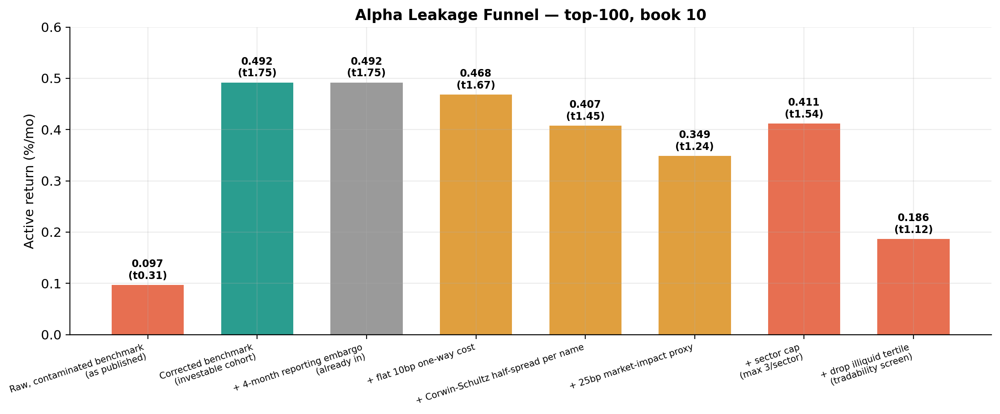

# Cost-adjusted multi-factor stock selection on the Singapore Exchange

Can you beat the Singapore market by ranking stocks on simple traits such as value, momentum and
quality, buying the best and selling the worst? The ranking works on paper, but in Singapore the
cost of trading and of borrowing shares to sell removes the gain before it can be traded at
institutional size.

Nicholas Hong, NTU EEE, supervised by Prof. Patricia Wong.

Every headline number below traces to an executed notebook cell or result file on real vendor
data, listed row by row in [VERIFICATION_LEDGER.md](VERIFICATION_LEDGER.md). Numbers from earlier
drafts that could not be traced to executed evidence were removed and are listed in
[EXCLUSIONS.md](EXCLUSIONS.md). Several of the notebooks the ledger cites are not in this
repository, so four cells in the tables below cannot be rechecked from the files here: the 59%
takeout share, the 694-firm count, the 36.4 bp half-spread and the TSMOM comparison.

## What I built

- A point-in-time universe of Singapore stocks: at each date, only the stocks that were index
  members then, including ones later delisted. Using today's members instead (survivorship bias)
  silently drops every firm that later delisted.
- A multi-factor model: eight traits (factors) per stock, each turned into a z-score (how many
  standard deviations a stock sits from the average that month) and combined into one score.
- A monthly long-short backtest: buy the top tenth of stocks by score and sell the bottom tenth
  (a decile long-short), then charge costs one layer at a time: spreads, borrow availability,
  borrow fees.
- A verification ledger that traces each claim to the run behind it, and a list of what was cut.

## Data

Licensed: Bloomberg, WRDS (Compustat Global, IBES, Markit securities lending, SDC),
CEIC and JKP extracts. No licensed data ships with this repository; `DATA.md` lists the sources,
licences and reproduction routes. Universes:

- Broad Compustat Singapore, 1991 to 2026, point in time.
- A 694-firm survivorship-free Compustat SGP sample for the survivorship tests.
- A 71-name point-in-time blue-chip roster, the STI (Straits Times Index) top-6 for the STI-core
  strategy, and the top-100 and liquid-100 by size and liquidity.

## Method

- Factors: 12-1 and 6-1 momentum, book-to-market, dividend yield, earnings yield, ROE, small size
  and Amihud liquidity, z-scored each month, with fundamentals lagged four months. The composite weights are fixed in advance
  (preset), equal, or re-estimated only on past data (walk-forward).
- The t-statistic is the average return divided by its standard error; values above about 2 are
  unlikely from chance alone. NW-t is the same with a Newey-West correction for autocorrelation.
- Spreads are estimated with the Corwin-Schultz method, which infers the bid-ask spread from daily
  high and low prices. Borrow uses Markit's real lending availability and fees.
- With many tests run, some pass by luck. Bonferroni and BHY are corrections that raise the bar
  for significance with the number of tests.

## Main result

Singapore has real, correctly signed, replicable cross-sectional return structure, and the result
does not hinge on the factor weights:

| Result | Number | Universe |
|---|---|---|
| Survivorship correction reverses the broad long-short | survivor t=1.01 vs point-in-time t=3.82 | Broad Compustat, 1991–2026 |
| Result does not hinge on the factor weights | preset 1.32%/mo (t=3.82), equal 1.01 (t=3.08), walk-forward 1.72 (t=4.58), at a flat 20 bp cost | Broad Compustat, 1991 to 2026 |
| Delisting survivorship bias is negative (dead names raise returns; 59% of exits are takeouts) | −0.89 pp/yr (bracket −0.88 to −0.50 under harsh terminal-return assumptions) | 694-firm survivorship-free Compustat SGP |
| Implementable long-short with real borrow (Markit) | +0.764%/mo (t=2.23) at S$50m AUM | top-100 |
| STI-core strategy | +0.396%/mo, NW-t 2.26; reproduces independently on Compustat at +0.36 (t=2.26) | PIT STI top-6 |
| Risk is jump-dominated | 57.9% jump variance; Gaussian understates 99% ES by 1.60pp (34%) | STI-core daily |

Two findings generalise beyond Singapore. Survivorship bias on SGX runs in the opposite direction
to the textbook prediction: dead names raise returns, because 59% of exits are takeouts. And the reference literature's factor premia do not reproduce under proper
multiple-testing control.





## What didn't work

| Result | Number | Universe |
|---|---|---|
| Cost waterfall on the preset composite | gross 1.661%/mo (t=5.13) → 0.366%/mo (t=1.08) fully costed; 0.06 to 0.54 across the four cost conventions, none significant. The walk-forward composite keeps more: 0.45 to 1.01, with t=2.03 and t=2.57 when costs are charged only on the names traded | Broad Compustat, 2003–2026 |
| Dominant cost | Corwin-Schultz spreads, 0.741%/mo (traded-days median half-spread 36.4 bp) | same |
| Long-only top decile after spreads | 0.09%/mo (t=0.36): the signal lives in the short leg, where borrow binds | same |
| Blue-chip naive backtest vs corrected | Sharpe 1.002 → 0.447 | 71-name PIT roster |
| Multiple-testing discipline | 65-test specification grid: 24 clear t=1.96, one clears t=3.0, zero survive BHY | dev window 1995–2019 |
| Reference paper's Table I | does not reproduce: 0 of 9 factors survive Bonferroni (best 2.767 vs 2.77) | PIT STI |
| Overlays (Barra, HMM, GBM, statistical jump model, IBES revisions, jump-aware sizing, GARCH targeting, Markov switching) | 8 tested, 8 failed to add risk-adjusted return. The last five have executed evidence; the Barra, HMM and GBM rows come from early sessions whose outputs are not kept, so they cannot be checked in detail (ledger E20, E21) | STI-core |
| TSMOM combination with fundamentals | reverses under borrow constraints (combo 0.460 < TSMOM 0.543) | liquid100 |





Errors found and fixed along the way. An early version of the pipeline fell back silently to a
seeded random generator when a Bloomberg export was missing, so its outputs were fabricated. That
was caught, every result downstream of it was thrown out and rebuilt on real data, and the
generator was reproduced exactly to confirm the contamination. Others: a forward-return alignment
bug that produced a false U-shaped payoff, a GARCH look-ahead that inflated Sharpe from 0.73 to
1.05, Markov smoothed probabilities worth a spurious +0.525 Sharpe, a benchmark built from t+1
index members that overstated the passive alternative by 0.395%/mo, a cost-base error behind a
spurious 1,400%/month turnover figure, the Corwin-Schultz liquidity-ordering inversion, and a
one-month target leak in the walk-forward of `code/backtest.py`. The research corrections are
logged in REPORT_FINAL.md section 12.

## How to run

```bash
pip install -r requirements.txt
cd code
python canonical_rerun.py   # broad-universe Tables 1 to 4
```

Every script runs on the licensed exports named at the top of the file, which need
NTU-equivalent entitlements (Bloomberg, WRDS Compustat/IBES/Markit/SDC, CEIC, JKP); `DATA.md` lists
the routes. `canonical_rerun.py` reads `sg_broad_quarterly.csv`, the quarterly Compustat panel
behind the broad-universe tables. The script that builds that panel is not in the repository yet.
The 30-name Bloomberg panel runs as `python pipeline.py`, then `python factor_model.py`, then
`python backtest.py`. `python make_figures.py` redraws three figures from `results/verified/` and
needs no licensed data.

Each script stops with an error if an input is missing. No script generates or falls back to
made-up data. Without the licensed exports, the result files in `results/verified/` and the
ledger are the evidence.

## What is where

| Path | Content |
|---|---|
| [REPORT_FINAL.md](REPORT_FINAL.md) | The research report; every number is tagged to a ledger row |
| [paper/SGX_Multifactor_Research_Report.pdf](paper/SGX_Multifactor_Research_Report.pdf) | The same report as a PDF |
| [STRATEGY_FREEZE.md](STRATEGY_FREEZE.md) | The locked strategy, the numbers at the freeze, and what counts as robustness |
| [VERIFICATION_LEDGER.md](VERIFICATION_LEDGER.md) | Claim-by-claim trace to executed evidence (VERIFIED / UNSUPPORTED / CONTAMINATED) |
| [EXCLUSIONS.md](EXCLUSIONS.md) | Everything cut from the report, and why |
| [MODULE_MAP.md](MODULE_MAP.md), `modules/` | How the research branches fit into one core result plus seven modules |
| [DATA.md](DATA.md) | Sources, licensing and reproduction routes; no licensed data ships |
| `figures/` | 46 figures at 200 dpi from real-data runs, except two that document corrections (`corr_synthetic_data_audit.png` plots the fabricated series that was caught, `core_deciles_precorrection.png` the payoff before a bug fix), indexed in [figures/README.md](figures/README.md); three are redrawn from shipped results by `code/make_figures.py` |
| `code/` | Pipeline, factor model, backtest, point-in-time engines, canonical re-runs and sensitivity scripts; [code/README.md](code/README.md) maps each headline result to the script or result file behind it |
| `src/` | VBA data layer: Bloomberg pulls, point-in-time index membership |
| `results/verified/` | Result files behind the ledger |
| `notebooks/` | Survivorship backtest; `backtest_survivorship_final.ipynb` is the canonical quarterly point-in-time run. Running it needs licensed Bloomberg/Compustat panels. It ships with its summary printout only (aggregate statistics, no vendor rows). Its numbers are in `results/verified/survivorship_summary_final.csv` (ledger B1, B9, B11). |

Educational and research use.
